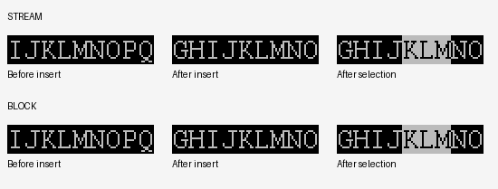

# Shift 按住不动时，应用仍能更新字符

候选 `abe6de57` 的单文件 [Windows x64 制品](https://github.com/xiongnemo/nemoterm/actions/runs/44773123053/artifacts/14649155549)，4,940,800 字节，SHA-256 `36d2434ea2645138eafc1ae54dbd4b48bb2ce82ef52a7f147ec261421ab8ff3d`。本页只确认下列交互；[完整回归](https://github.com/xiongnemo/nemoterm/actions/runs/44773123053)另行计分。

应用启用鼠标跟踪时，按住 Shift 和左键指向 `K`。应用在左边插入两格，把 `KLM` 连同后面的文字往右移动两格。此时窗口在原位置再次收到鼠标移动消息，指针所在的屏幕格子没变。旧版把移动后的文字位置误认为鼠标按下的位置，提前进入拖选并暂停处理终端输出。[修复前的窗口消息对照](https://github.com/xiongnemo/nemoterm/actions/runs/44772466056)在普通选区下等满 8 秒：子程序没有在松手前收到新的状态回复，矩形用例未运行。另一次自然出现的超时没有记录这一条鼠标消息，不能断定原因相同。

修复版分别记住鼠标按下的屏幕格子和应用移动后的文字位置。[托管 Windows 专项](https://github.com/xiongnemo/nemoterm/actions/runs/44774363108)在同一份单文件、GDI、默认 profile 字体和右侧标签栏下，用原来的 8 秒等待判定。普通 Shift 和矩形 Ctrl+Shift 两种场景都在松手前得到新的状态回复，随后拖到第 14 列（从零开始计列）。独立复核使用每个场景的三张原始 PNG，确认 `KLM` 从第 10–12 列移动到第 12–14 列，选中行及上下两行一共 240 格中仅这三格发生高亮变化。默认右键、Ctrl+Shift+C 均读回 `KLM`，子程序未收到本地手势的鼠标字节。两个新用例使用确定坐标的窗口消息；整个脚本的 60 个窗口消息横向编辑用例和另列的 15 个系统实按横向编辑用例均通过。

[修复后的原始截图、输入和复制记录、产品与夹具身份、REA 静态导入表](stationary-abe6de57.zip) · [旧版原始超时记录](stationary-before-28a2da26.zip)。图中为原始画面的最近邻放大裁剪；判定使用未缩放的原始图片。
