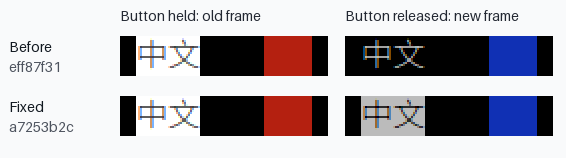

# 同步刷新期间，Shift 拖选与已高亮的右键复制

[旧版本的原始测试](https://github.com/xiongnemo/nemoterm/actions/runs/44726931350)使用提交 `3308de918ee351d780bcf58f94a9b81e0986e8dd` 的可执行文件（SHA-256 `81727d3ba0a9c8deb51dd35923041081527e74645e799d9bc8ad79e52ac1fd44`）。两台 GitHub 托管 Windows 机器分别使用 GDI 和实际 DirectX、固定的 Sarasa Light、真实鼠标与键盘输入。窗口外读取所属渲染表面的像素；没有在前端装钩子。

| 手势 | 按下时显示 | GDI、DirectX 剪贴板 | 应用收到手势 |
| --- | --- | --- | --- |
| 正常显示后 Shift 拖选，快捷键复制 | 中文 / 明月 | 对应的中文 / 明月 | 否 |
| 已有隐藏的新帧时开始 Shift 拖选，快捷键复制 | 中文 | **明月** | 否 |
| 先选中文字，隐藏写入后按复制快捷键 | 高亮的中文 | 中文 | 否 |
| 同一已高亮选区，隐藏写入后点默认右键 | 高亮的中文 | **仍是原来的哨兵文字** | **右键按下及松开** |

全部冻结场景在 225–285 毫秒左右完成（精确值在 JSON 内），小于应用的一秒超时。屏幕上的红色方块标记旧帧，蓝色标记新帧。完整抓图和原始制品见[证据包](sync-selection-3308de91.zip)：独立解码的按下前后同位置像素、色块和原始子程序回复均保留。每种渲染器原始结果为 3/5，之前的字形测试要求先发布隐藏帧，不能作为这个场景的通过依据。

后续版本 `2910fe09` 的[两份托管记录](https://github.com/xiongnemo/nemoterm/actions/runs/44727792517)每种渲染器通过 8/9 项：已有高亮时，默认右键和显式快捷键都复制了「中文」；允许应用用 OSC 52 写入私有选择后，复制仍来自可见高亮。可选右键同时复制并粘贴也传给子程序同样的 UTF-8 文字。发布新帧后，未选中位置的右键恢复发给应用。这一版本仍然在新拖选时取到了「明月」。[原始制品及独立像素复核](sync-selection-2910fe09.zip)保留了这项失败。

在 `282b289a`（EXE SHA-256 `984baa55ef23f7cc1f35e16be0cde7023e7fc962c12cc988bd71f2a160a68637`），[GDI](https://github.com/xiongnemo/nemoterm/actions/runs/44729741150/job/136268407846) 和 [DirectX](https://github.com/xiongnemo/nemoterm/actions/runs/44729741150/job/136268407782) 分别通过 11/11 项。窗口外读取的 PNG 独立解码后：普通拖选、按住超过一秒再松开，以及 Ctrl+Shift 矩形拖选，均只改变所选的四格，显示原来的「中文」字形；松开后子程序继续，剪贴板是「中文」。在这三个 80×24 小窗口用例中，按住时私有工作集最高的采样值分别为 4,792,320 和 7,155,712 字节，不是整个会话的内存峰值。[两份原始制品和逐项像素复核](sync-selection-282b289a.zip)；可用 `scripts/review-sync-selection.py --generation drag` 读取其中两份原始 ZIP。

在 `eff87f31` 上，原来的 11 项在 GDI 和 DirectX 仍全部通过。[另一次托管对照](https://github.com/xiongnemo/nemoterm/actions/runs/44731633440)固定了同一 EXE（SHA-256 `abe6d263f4526cd76c50be2109b7faaa8a9fd0afd9ec80b503c9636bb9693de9`），只更新所选「中文」右侧的色块。拖选时四格都正确，快捷键也复制了「中文」，但蓝色块显示后四格高亮消失；普通和矩形两种选择的右键都被传给了子程序，Windows 剪贴板未更新。改动所选文字本身时，高亮正常撤掉，子程序收到右键。两种渲染器各 11/13。[原始 PNG、剪贴板、子程序记录和独立复核](sync-selection-neighbour-eff87f31.zip)；用 `scripts/review-sync-selection.py --generation adjacent` 读取包内两份原始 ZIP。

`a7253b2c` 的[远程 GDI](https://github.com/xiongnemo/nemoterm/actions/runs/44732257820/job/136276661144) 和[远程 DirectX](https://github.com/xiongnemo/nemoterm/actions/runs/44732257820/job/136276660934) 使用同一份 EXE（`be4a655b3ae9fa1174876436f728b54f93c8777433bfcc8239ce355bfd12adda`），各通过 13/13 项。普通和矩形拖选都保留了「中文」的四格高亮；提交新帧后重新放入剪贴板哨兵，再点默认右键，得到「中文」，子程序没有收到鼠标事件。对照中如果「中文」本身换成「明月」，高亮消失，子程序收到右键的按下和松开，剪贴板哨兵保持不变。[两份原始制品及独立复核](sync-selection-neighbour-a7253b2c.zip)。

下图取自 GDI 两版的实际窗口。左侧按住鼠标时都正确；右侧色块变蓝代表下一帧已显示，只有修复版保留了所选文字的灰色背景。截图局部按整数倍放大。

