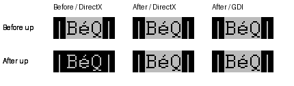

# 跨标签松开 Shift 拖选

A 与 B 在同一个原生终端窗口中运行，各自打开应用鼠标报告和括号粘贴。先选中 B 中的 `BéQ`，再在 A 中按住 Shift 和左键，拖到新位置。左键尚未抬起时用 Ctrl+Shift+Tab 返回 B，在 B 的文字上松开。B 从未收到这次手势的按下事件，应保留原选区；A 的未完成选区则应该取消。单独按 Ctrl+Shift+C 能读到先前缓存的文本，不能据此证明屏幕高亮还在。因此逐格比较同一窗口的原图和操作前后的截图，并以两个子进程的输入回执检查是否发生串键。

[旧版系统键鼠回放](https://github.com/xiongnemo/nemoterm/actions/runs/44522817574)使用 `dist` 预览 `0d8f731`（SHA-256 `8e8fdd89176d0204d72c05fd62b8bb62754eba052fab2c8e399bc8bc8fa7af12`）。[原始截图、输入和断言](tab-drag-before-0d8f731.zip)表明：从 GDI 切到 DirectX 后、松开鼠标前，B 的五个格子 `|BéQ|` 相对未选中画面的差异比例是 `[0, 1, 1, 1, 0]`；抬起后变成 `[0, 0, 0, 0, 0]`。在两个窗口的输入屏障之前，都没有应用鼠标报告混入。原失败为 tabs 组 8/9。

候选 `6a2dc83` 只在本终端有待完成的按下事件时，用一次原地抬起清除选区；抬起不再清掉此前已经完成的选区。已开始的拖选仍正常完成。核心用例分别覆盖开启和关闭应用鼠标、选择键和扩展键的孤立抬起、普通原地点击清除。完整构建和回归见[候选运行](https://github.com/xiongnemo/nemoterm/actions/runs/44523229386)。

[新版本的系统键鼠回放](https://github.com/xiongnemo/nemoterm/actions/runs/44524065933)使用候选 EXE `39c3b368061f104858dff466dd5a2416887c76dfc94481be68f9d7b79841d450`，标签分组 **9/9**。用两个全新的双标签窗口分别测 GDI → DirectX、DirectX → GDI。切过去后松手，两边都保留 `|BéQ|` 中间三个选中字格，边界没有变色；Ctrl+Shift+C 复制 `BéQ`。回到原标签后，未完成选区消失，两个子进程的完整输入流除预期粘贴和状态回复外没有其他字节，最后都正常退出。[逐阶段记录、截图与测试制品身份](tab-drag-after-6a2dc83.zip)。

[离线对照脚本](../scripts/compare-tab-drag-records.py)从两个回放制品直接读取截图，和未选中同一行的像素比较，再生成上图。按次序输出旧版 `01110 → 00000`、新版两个方向均为 `01110 → 01110`。

该候选在 [10 次同机 pterm / Nemoterm 对照](tab-drag-pterm-6a2dc83.zip)中使用同一个 Codex 和 `SarasaTermSC Nerd Light`（160×48）。在收到回复后采样，各次前端私有工作集中位数范围：pterm 3.744–3.768 MB，Nemoterm 单标签 GDI 5.050–5.100 MB，DirectX 9.654–9.728 MB。数字使用十进制 MB。八个 Nemoterm 进程用的是同一个候选 EXE。新版的[REA 导入表](rea-6a2dc83-imports.json.gz)与旧版在普通和延迟导入上全部字段相同；静态导入不能替代运行时模块观测。

同一 EXE 的[其他专项记录](tab-drag-acceptance-6a2dc83.zip)：默认网格真实客户端 10/10、选区 6/6，英文和简体中文的实际系统 DPI 各 12/12。[构建清单与关闭确认回执](tab-drag-build-6a2dc83.zip)中的三个窗口场景，在取消后均恢复输入。

远程完整 CI 中，WSL 的 Sixel、tmux/Vim、terminfo 颜色以及 Linux 上构建 BusyBox 的作业都曾在安装依赖时失败：Ubuntu 镜像的 HTTP 连接超时或索引不完整，产品尚未进入测试。工作流现在先检查请求的软件包；确需安装时，使用 HTTPS 并要求 Ubuntu 签名索引验证成功，记录实际包版本。BusyBox 仍从原有固定源码和 Unicode 配置交叉编译。只使用 GitHub 托管 runner，不依赖开发机 WSL 或 `/tmp`。

同一候选上的 [Sixel 回放](https://github.com/xiongnemo/nemoterm/actions/runs/44525493045)（两种渲染器）、[tmux/Vim 回放](https://github.com/xiongnemo/nemoterm/actions/runs/44525492410)（GDI、DirectX 各 `TERM=xterm`、`xterm-256color` 两种）以及 [terminfo 颜色回放](https://github.com/xiongnemo/nemoterm/actions/runs/44525560769)（两种渲染器）均通过。[原始失败摘录与日志摘要、新回放原件和包清单](tab-drag-wsl-6a2dc83.zip)包含 BusyBox 重建记录。[修正准备流程后的 81 项交互总回放](https://github.com/xiongnemo/nemoterm/actions/runs/44525718005)与首次完整 CI 分开记录。

本次发布到 `dist` 的测试版与上述候选字节相同，4,858,368 字节。[同一 EXE 的两组压力记录](tab-drag-memory-6a2dc83.zip)包含 160×48 的六种负载，每组 6/6。GDI 前端私有工作集峰值为 19,578,880 字节，总工作集峰值 56,381,440 字节；DirectX 分别为 29,061,120 和 74,297,344 字节。各列单独取峰值。
