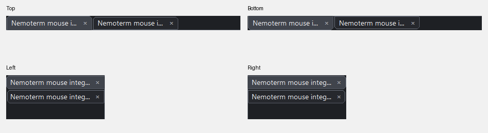
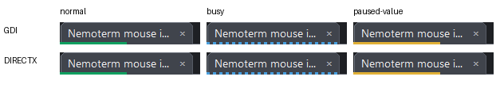

# Windows x64 试用版 `3da1ebb8`：经典 Win32 属性页式标签

[下载单文件](https://github.com/xiongnemo/nemoterm/actions/runs/44778524143/artifacts/14651845827)，解压后运行 `nemoterm.exe`。文件为 4,942,336 字节，SHA-256 `ff51561c1f0ff279ff0e85ea2f8f8eed8fe2892536477f5aba96aac63dc55763`。

标签保留 Nemoterm 的深色配色。外侧两角削斜，选中页的底边向终端敞开；放在左右侧时文字和关闭按钮仍横向显示。只改标签栏的 GDI 绘制，不增加随程序分发的库。

[原始截图和手势回执](tab-faces-3da1ebb8.zip)直接来自[托管 Windows 测试](https://github.com/xiongnemo/nemoterm/actions/runs/44778524143/job/136438238242)。四边各实际切换一次，八张原图验证两个削角和选中页与内容区的接缝。四边均确认后台终端更新后悬停预览随之变化，点击后键盘到达正确终端，实际拖选复制得到 `Copy7`。中键的同页松开、跨页松开、新建按钮、取消、目标标签自行退出五种情况逐边检查，20/20 通过。

**应用进度条（OSC 9;4）：** 首轮 GDI、DirectX 均未进入用例：旧夹具在第二条扫描线的第一个像素查找矩形标签填色，这里现在是削角。换用客户端和 DPI 量宽之后，[同一 EXE 的专项回放](https://github.com/xiongnemo/nemoterm/actions/runs/44780773296)在两种渲染器上各通过 16 项。判定包括各进度状态的颜色、位置和完整带宽；两种情况下 Windows 外壳的调用也成功。启用进度的双标签 Unicode/Kitty 压力场景中，前端私有工作集峰值是 GDI 19,648,512 字节、DirectX 29,028,352 字节。这个单项独立于六种满屏压力负载的汇总。

[两份最初失败制品、同一 EXE 的复测制品及独立像素统计](tab-progress-3da1ebb8.zip)。

[该 EXE 的完整回归](https://github.com/xiongnemo/nemoterm/actions/runs/44778524143)另计；[上一试用版的 80/81 项交互及内存成绩](acceptance-abe6de57.md)对应上一份 EXE。
