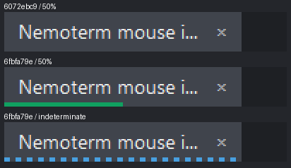

# 标签栏与 Windows 任务栏的应用进度

在候选 `6fbfa79e` 中，长时间运行的命令可以用 OSC 9;4 显示进度。每个标签分别显示；任务栏只有一个按钮，所以后台报错可以覆盖前台的普通进度，关闭报错标签后恢复其余标签的状态。未知进度在标签栏中用条纹表示，无需动画计时器。



上图是远程 runner 对同一位置的实际像素裁剪，按整数两倍放大。两个版本使用相同的窗口像素回放，字体均为 SarasaTermSC Nerd Light。旧版每种后端均仅通过 5 个应当空白的对照；11 个应当出现进度的步骤全部空白。新版 GDI 和 DirectX 均为 **16/16**。此外每种后端 4 次独立窗口、8 次多标签窗口观测均符合预期：起始窗口未尝试使用任务栏 COM 对象；有进度后的更新成功返回；同级选中标签优先，错误优先于暂停，关闭后台标签后重新计算。这里实际截取的是应用标签栏；任务栏证据是 Explorer 按钮就绪通知及 Windows API 的返回值。

[旧版原始制品](taskbar-progress-before-6072ebc9.zip) · [候选窗口与任务栏原始制品](taskbar-progress-after-6fbfa79e.zip) · [GitHub Actions 完整回归](https://github.com/xiongnemo/nemoterm/actions/runs/44603212443)

在 PowerShell 中可直接试相同的序列：

```powershell
$esc = [char]27
[Console]::Write("$esc]9;4;1;50`a")  # 50%
[Console]::Write("$esc]9;4;4;0`a")   # 暂停，保留 50%
[Console]::Write("$esc]9;4;0`a")     # 清除
```

启用任务栏进度的内存回放中，两个标签都保留 2,000 行历史，分别输出 4,096 行，再运行 24 帧混排文字、Sixel 和 Kitty Unicode 图像以及 24 次窗口大小变化。采样前后都检查了前一标签为 60%、后一标签为暂停 25%，Shell 接受的聚合状态为暂停 25%。下表为前端进程的峰值，MB 为十进制，未计入两个子程序及其控制台宿主。

| 实际后端 | 私有工作集 | 总工作集 | 私有提交 | 前端采样次数 |
| --- | ---: | ---: | ---: | ---: |
| GDI | 19.21 MB | 54.00 MB | 22.95 MB | 1,625 |
| DirectX | 28.77 MB | 72.06 MB | 32.53 MB | 1,125 |

两个 runner 都使用实际 160×48 和 SarasaTermSC Nerd Light，正常退出并恢复显示配置。[启用进度后的内存回放](https://github.com/xiongnemo/nemoterm/actions/runs/44604933875) · [原始成功及首次尺寸准备失败的制品、精确字节数、导入变化](taskbar-memory-6fbfa79e.zip)。首次运行在 123×32／99×33 即停止，没有从它推断内存。

[同一远程构建制品](https://github.com/xiongnemo/nemoterm/actions/runs/44603212443/artifacts/14568968088)：单文件 4,881,920 字节；SHA-256 `e3b6346d3f370d57d7004a0a5a0c77397537885a80755c781979557ce3be32f9`。REA 读取该文件的标准及延迟导入表（674 + 11 项）。逐项比对上一候选，未增加 DLL 名称；静态导入不能证明运行时加载集合。
