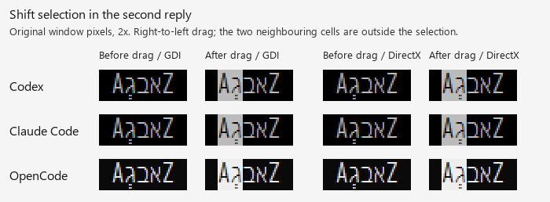

# `fe5f98f9`：真实终端应用的交互验收

[当前 Windows x64 单文件](https://github.com/xiongnemo/nemoterm/actions/runs/44820130857/artifacts/14672630186) 是 4,943,360 字节的 `nemoterm.exe`，SHA-256 为 `16611c7653efc06b42c42a492d12b14b077d4c934e6bc4e55e4531eedb7411d5`。下列结果均来自该 EXE。Windows 桌面运行在 GitHub Actions 上，网格为 160×48，字体为 SarasaTermSC Nerd Light。运行的是真实客户端，模型服务由测试接收器代替；能核对它收到的原文和图片，不调用线上模型。

**鼠标与剪贴板。** Codex、Claude Code 和 OpenCode 分别使用 GDI 和 DirectX，在应用接管鼠标时真实按住 Shift 拖选。六个组合各检查三种方式：Ctrl+Shift+C 后 Ctrl+Shift+V、默认右键仅复制后另按粘贴键、可选的右键同时复制粘贴。[18/18 通过](https://github.com/xiongnemo/nemoterm/actions/runs/44822969919/artifacts/14672293897)。两个边界外的相邻格都没有被选中，测试服务核对了提交的完整 Unicode 内容。

**混合文字的显示顺序。** 在十个真实窗口各做两次拖选：首先从左向右选，收到下一条回复后反向选。在两次操作中，[独立复核](https://github.com/xiongnemo/nemoterm/actions/runs/44822969330/artifacts/14671083754)逐格比对了原始 PNG 中三个可分辨的希伯来字形，与实际客户端写入的两段 VT 字节、系统剪贴板交叉核对。四个窗口的客户端输出逻辑顺序，六个已经重排；20/20 次复制均为 `U+0041 U+05D2 U+05B0`（A、希伯来字母 gimel 和其下的 sheva）。两个选中格的背景全部变为高亮色，左右相邻格背景全部保持原样。反向拖选前用图像清除了剪贴板里的文字；十次都收到恰好一份与所复制码位相符的提交。十个窗口包含 Claude 由 PowerShell 启动及显式视觉顺序的情形。

**图片粘贴。** [本版原始客户端记录](https://github.com/xiongnemo/nemoterm/actions/runs/44820130857/artifacts/14671888963)保留了两个时机。Codex 输入框就绪后，Ctrl+V 和 Ctrl+Shift+V 通过窗口消息或真实键盘触发的四种组合，均首次提交就收到了图片，未重复发送。输入框刚出现时，两个原始用例均失败；保留结果，不把就绪前接图当作试用要求。[中英文关闭确认及取消后继续输入](close-dialog-language.md)另有 8/8 通过。

**内存口径。** 以下为终端前端进程的私有工作集峰值（十进制 MB），不含 shell、agent 或控制台宿主。两张表的负载不同。[同一托管 Windows 机器上的 24 轮 Codex](https://github.com/xiongnemo/nemoterm/actions/runs/44820130857/artifacts/14671853298)中，pterm 为原版 0.85；[三个应用的交互窗口](https://github.com/xiongnemo/nemoterm/actions/runs/44822969330/artifacts/14671083754)含选区、输入、提交和回复。数字是采样峰值，不外推为采样间的瞬时上限。

| 24 轮 Codex | 私有工作集 | 总工作集 | 私有提交 |
|---|---:|---:|---:|
| pterm 0.85 | 3.76 MB | 22.72 MB | 4.46 MB |
| Nemoterm GDI | 5.47 MB | 34.54 MB | 6.80 MB |
| Nemoterm DirectX | 9.76 MB | 44.88 MB | 11.28 MB |

| 十个交互窗口，按应用取峰值 | GDI 私有工作集 | DirectX 私有工作集 |
|---|---:|---:|
| Codex | 13.24 MB | 20.83 MB |
| Claude Code | 13.17 MB | 18.69 MB |
| OpenCode | 12.17 MB | 17.94 MB |

**满屏压力与严格总评。** 同一份 EXE 的[内存复核](https://github.com/xiongnemo/nemoterm/actions/runs/44820130857/artifacts/14672663248)逐条读取六种 160×48 负载的前端样本。两种渲染器均在 Unicode 与 Kitty 图像混合负载中达到最高私有工作集。下表用字节，便于对照十进制门槛；总工作集另列。

| 六种满屏负载 | 私有工作集峰值 | 距私有上限 | 总工作集峰值 |
|---|---:|---:|---:|
| GDI | 19,230,720 | 769,280 | 56,074,240 |
| DirectX | 28,880,896 | 1,119,104 | 72,114,176 |

[原始严格交互](https://github.com/xiongnemo/nemoterm/actions/runs/44820130857/artifacts/14672757184) **79/81**，81 项全部执行。未通过的两项正是上面列出的 Codex 首次显示输入框时贴图。Vim 及 tmux 中的 Vim 在两种渲染器和两种 `TERM` 设置（`xterm`、`xterm-256color`）下的矩形复制、粘贴记录已核对；[八帧 Sixel 与实际应用、进程及内存的完整验收报告](https://github.com/xiongnemo/nemoterm/actions/runs/44820130857/artifacts/14673231701)同时保留了原始失败。十个应用窗口在启动和提交后各做一次模块及进程采样，这 20 次均未发现已知 WebView 或浏览器进程标记。

上述是交互验收，不代表完整复现 XTerm。[协议覆盖表](../docs/PROTOCOL_COVERAGE.md)区分已验证、部分支持和缺项。独立协议对照仍报告 ReGIS 中间帧及[三个宽字边界格](column-edge-integrity.md)等差异；WSL1 引用粘贴、进程退出时限和像素尺寸也单独计分。

[包含双向选区的汇总回放](https://github.com/xiongnemo/nemoterm/actions/runs/44824034776/artifacts/14673975450)使用同一批 Windows 原始记录。新复核通过，严格总评仍为 79/81。[可离线查阅的记录包](trial-fe5f98f9.zip)包含原总评、补充总评、两项内存记录、快捷键回执、十个窗口的原始拖选画面和客户端字节。`sources.json` 记录 GitHub 原始制品编号和 SHA-256；`receipt.zip` 与托管制品逐字节相同，`bidi-surfaces.zip` 只收录本次双向文字复核读取的原始成员。用 `scripts/review-agent-bidi.py receipt.zip bidi-surfaces.zip bidi.json` 可在允许的远程环境重做该项复核。
