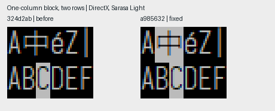

# Selecting a displayed character by its trailing cell

In the [exact `324d2ab` replay](wide-selection-before-324d2ab.zip) (hosted run `44313522366`, artifact `14431596694`, SHA-256 `52dcf98d193a5458c38e530945b8ac19c1f0b16a9be28bca84322195f0571fd8`), GDI and DirectX agreed on all eight observations. With application mouse reporting on, Shift-drag from the second cell of `中` to the following `e` + U+0301 selected and copied only the latter. A reverse drag missed the same glyph. A rectangle covering the trailing cell of `中` on the first row and `C` on the second produced an empty first row. Starting at the leading half, or dragging between the two halves, already copied `中` once. All gestures delivered just the two synchronization replies to the peer.

A separate case retained both selection highlight and the neighboring U+10001 but dropped U+10000 from the clipboard. The Windows rendering and clipboard conversions both excluded the first supplementary code point from their UTF-16 surrogate-pair branch. The regression checks exact text for both neighboring scalars. It does not check font coverage of these Linear B glyphs.

The single executable from `a985632` is 4,860,416 bytes, SHA-256 `0ea3aa4ccefceecc705622ce690ca2241c87c77bd7228e65b4def03507b00bde`. On that exact image in full run `44314169646`, [actual GDI and DirectX](wide-selection-after-a985632.zip) matched clipboard text, highlight extents and application input in all eight scenarios each (artifact `14431877197`, SHA-256 `5677bd1cb6eadf3e8f684ed28edf11c67c0d45177e6f293670f2752008841dcd`). A one-column rectangle starting in the second half of `中` now includes that glyph once, leaves the narrow row directly underneath one cell wide, and copies `中` followed by a line break and `C`. The adjacent U+10000 and U+10001 both survive the clipboard round trip. No glyph metrics or application mouse reports are synthesized to achieve this.

In [real-client replay `44315241832`](wide-selection-real-clients-a985632.zip), Codex, Claude Code and OpenCode each requested application mouse tracking. Each used a real system Shift-drag at 160×48 with the pinned Sarasa Light font, once on GDI and once on DirectX. Press on the right half of `中`, release on the left half of `文`: all six showed a four-cell highlight, both adjacent guard cells remained unchanged, and Ctrl+Shift+C copied exactly `中文`. Each subsequently selected and pasted the original longer reply and obtained the expected loopback provider receipt. The highest sampled frontend private working set during those six sessions was 12,095,488 bytes on GDI and 21,848,064 on DirectX. These samples are separate from dense graphics stress. Original artifact `14431644860`, SHA-256 `6f73129e2fa5cbf96d45c4dcf3f0f9eac1cabdbdb01e65f82418ac2832ee80a3`.

For this exact preview the [REA static PE import record](rea-a985632-imports.json.gz) decoded 669 standard and 11 delayed function imports, with no WebView2, CEF, Electron or WebKit module declared. During those six agent sessions, all twelve startup/submission module and process snapshots also found none of the known browser runtime names checked by `tests/frontend_runtime_snapshot.py`. The PE import table alone cannot exclude dynamically loaded or statically embedded code. The renderer, input and window implementation is native; the shell and agent child processes are accounted separately. For the original pterm comparison see [the binary and memory investigation](pterm-findings.md).
